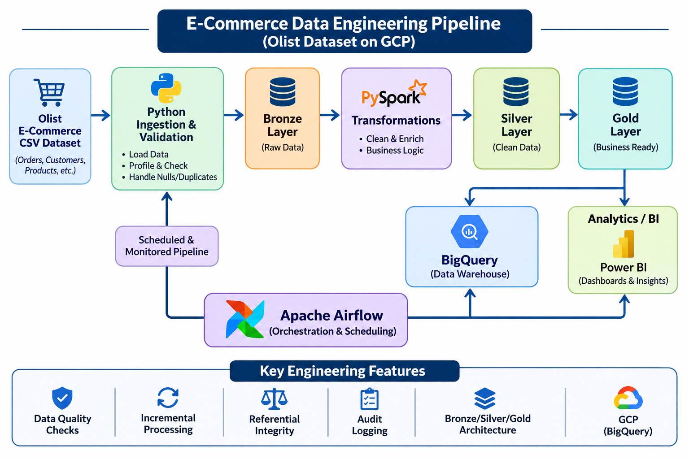
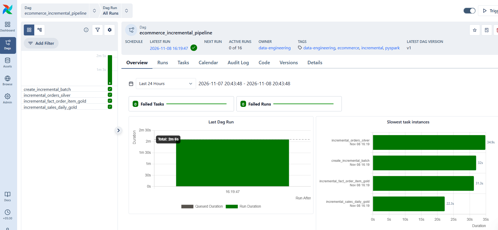

# GCP E-Commerce Data Engineering Pipeline

An end-to-end data engineering project built using the Olist Brazilian E-Commerce dataset.

## Project Overview

This project demonstrates a production-style e-commerce data pipeline using:

- Python
- PySpark
- Apache Airflow
- GCP-oriented data engineering architecture
- Data quality validation
- Incremental processing
- Idempotent pipeline design
- Silver and Gold data layers
- Audit logging
- Analytics-ready datasets

The source dataset is static historical data. Incremental ingestion is simulated by partitioning historical orders by `order_purchase_date`.

## Architecture

### Airflow Orchestration

The pipeline is orchestrated using Apache Airflow with four sequential tasks:

1. Create Incremental Batch
2. Incremental Orders Silver
3. Incremental Fact Order Item Gold
4. Incremental Sales Daily Gold


```text
Olist CSV Dataset
       |
       v
Python Ingestion & Validation
       |
       v
Raw / Bronze Layer
       |
       v
PySpark Silver Layer
       |
       v
Gold Analytics Layer
       |
       +----------------------+
       |                      |
       v                      v
Fact / Dimension Tables   Performance Metrics
       |
       v
BI / Analytics


Data Layers
Bronze / Raw
Original source CSV files are treated as raw input.

Raw data is intentionally excluded from GitHub.
Silver
The Silver layer standardizes schemas, timestamps, column names and data quality.

Datasets include:
- Orders
- Customers
- Order Items
- Products
- Sellers
- Payments
- Reviews
Gold
The Gold layer contains analytics-ready fact and dimension datasets.

Examples:
- fact_order_item
- fact_order_item_final
- dim_customer
- dim_product
- dim_seller
- dim_date
- sales_daily
- sales_by_category
- seller_performance
- customer_performance
- product_performance
- delivery_performance
- payment_method_performance
Incremental Pipeline
The project simulates daily incremental ingestion using historical order dates.
Batch Date
    |
    v
Create Incremental Batch
    |
    v
Incremental Orders Silver
    |
    v
Incremental Fact Order Item
    |
    v
Incremental Sales Daily

The incremental pipeline is designed to be idempotent.

If the same batch is processed again, duplicate orders are removed rather than duplicated in the consolidated Silver layer.
Airflow Orchestration
Apache Airflow orchestrates the incremental pipeline through four sequential tasks:
1. Create incremental batch
2. Process incremental Orders Silver
3. Build incremental Order Item Gold
4. Build incremental Sales Daily Gold
The DAG is:

ecommerce_incremental_pipeline

The DAG accepts a batch_date through the DAG run configuration.

Example:
{
  "batch_date": "2018-01-03"
}

Data Quality
The project includes configuration-driven and incremental data quality validation.

Checks include:
- Row count validation
- Required column validation
- Primary key null checks
- Primary key uniqueness
- Business rule validation
- Referential integrity
- Incremental batch validation
- Audit logging
Example business rules:
- Order IDs must not be NULL
- Order IDs must be unique
- Payment values must be non-negative
- Review scores must be between 1 and 5
- Order item revenue must be non-negative
- Fact records must reference valid customers, products and sellers
Audit Logging
Pipeline execution metadata is written to audit datasets.

Audit information includes:
- Run ID
- Pipeline name
- Run timestamp
- Dataset
- Layer
- Row counts
- Pipeline status
- Error information
- Incremental batch metrics
Example Incremental Pipeline Result
Batch Date: 2018-01-03
Incoming Orders: 225
Incremental Fact Rows: 247
Distinct Orders: 222
Total Items: 247
Total Revenue: 36746.08
Average Order Value: 165.52
Pipeline Status: PASSED

The example demonstrates successful incremental processing and idempotent reruns.
Project Structure
gcp-ecommerce-data-engineering-pipeline/
|
├── dags/
│   └── ecommerce_incremental_pipeline.py
|
├── ingestion/
│   ├── create_incremental_batch.py
│   ├── incremental_orders_silver.py
│   ├── profile_data.py
│   ├── run_incremental_pipeline.py
│   └── validate_data.py
|
├── spark_jobs/
│   ├── Silver transformation jobs
│   ├── Gold dimension jobs
│   ├── Gold fact jobs
│   ├── Performance analytics jobs
│   └── Incremental Gold jobs
|
├── tests/
│   ├── audit_logger.py
│   ├── data_quality_config.py
│   ├── data_quality_framework.py
│   ├── incremental_data_quality.py
│   └── verify_silver.py
|
├── docs/
│   └── data_quality_rules.md
|
├── requirements.txt
├── README.md
└── .gitignore

Data Engineering Concepts Demonstrated
- ETL / ELT pipeline design
- Batch processing
- Incremental data processing
- Idempotency
- PySpark transformations
- Data quality engineering
- Referential integrity
- Dimensional modeling
- Fact and dimension tables
- Audit logging
- Workflow orchestration
- Failure handling
- Pipeline validation
- Analytics-ready data modeling
Technologies
Technology	Purpose
Python	Ingestion, validation and orchestration
PySpark	Data transformation
Apache Airflow	Workflow orchestration
GCP	Target cloud architecture
BigQuery	Target analytical warehouse
Git / GitHub	Version control


Dataset
The project uses the Olist Brazilian E-Commerce Public Dataset.

The original raw dataset is not included in this repository.
Future Improvements
- Deploy ingestion to Google Cloud Storage
- Run Spark transformations on Dataproc
- Load Gold datasets into BigQuery
- Add Cloud Composer deployment
- Add CI/CD using GitHub Actions
- Add BI dashboards
- Add monitoring and alerting
- Add production-style configuration management


Author
Data Engineering portfolio project demonstrating practical Python, SQL, PySpark, cloud and orchestration skills.